# Hi, I'm Nishant 👋

Welcome to my GitHub profile! 👋 I enjoy building projects and exploring new technologies. 🚀

- 👨‍💻 I am [Nishant](https://github.com/nishant-af) 19 yo Coder boy
- 🎮 I am a coder, Gamer, Dreamer, Overthinker ✨
- 🎬 Outside of coding, I love watching sci-fi movies and Play Story Driven Games 🎮
- 🛠️ I Love C/C++ Programming 

## Technologies

## GitHub Arcade

## Top Languages

<table>
  <tr>
    <td></td>
    <td>
      <table>
        <tr><th>Social Links</th></tr>
        <tr><td> </td></tr>
        <tr><td></td></tr>
        <tr><td></td></tr>
      </table>
    </td>
  </tr>
</table>
